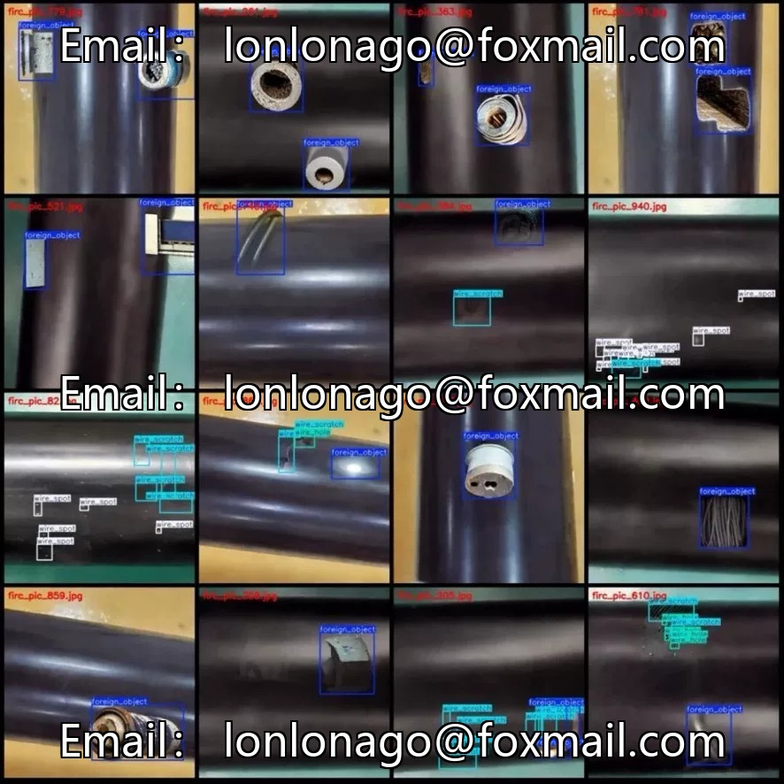
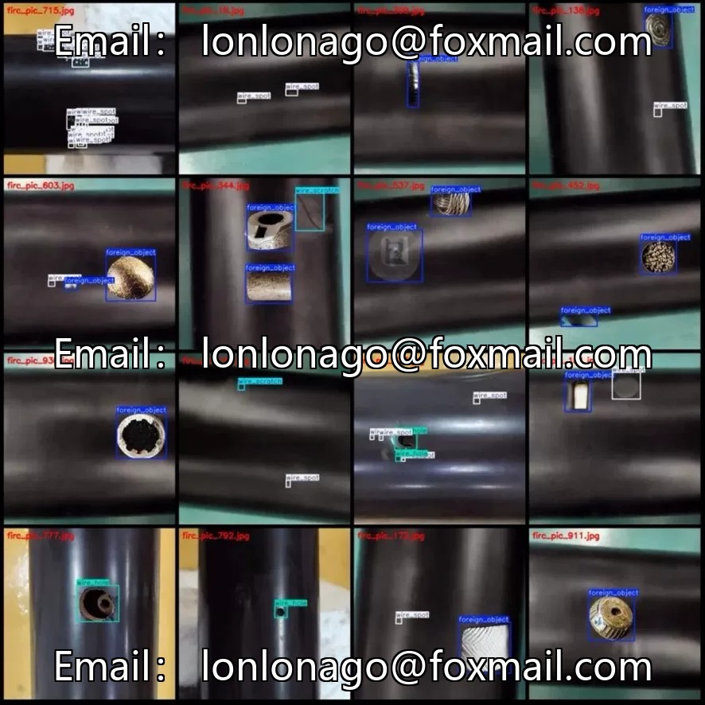
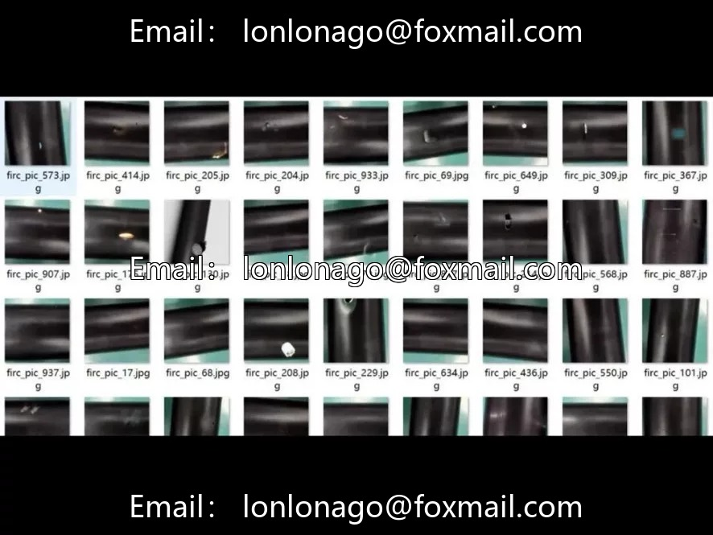

# Cable wire black skin defect detection dataset (synthetic), 975 images, covering 4 categories

## Body

Cable Black Pigmented Wire Defect Detection Dataset (Synthetic), 975 images, covering 4 common cable defects: foreign object adhesion, cable hole, cable scratch, cable spot

Task Type: Object Detection
Total Images: 975
Number of Categories: 4
Annotation Formats: Pascal VOC (XML) + YOLO (TXT)
Image Resolution: 512×512
Annotation Tool: LabelImg
Data Partitioning: Not partitioned, user needs to partition it themselves
Data Nature: Synthetic images, suitable for algorithm pre-research and validation.

Suitable for industrial quality inspection, wire manufacturing scenarios, can be used for defect detection algorithm development, teaching research, transfer learning and so on.

Virtual materials, once sold, are non-refundable.
Interested friends, click "I want" to proceed.

## Images

## Payment

Here is a pay link on Stripe ( https://buy.stripe.com/3cs8yP7sY87d0vu9AB ). Please contact me lonlonago@foxmail.com after funding $89, and I will send you a complete data files , thank you!

